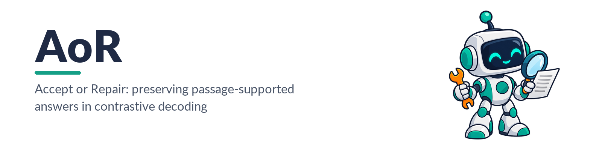
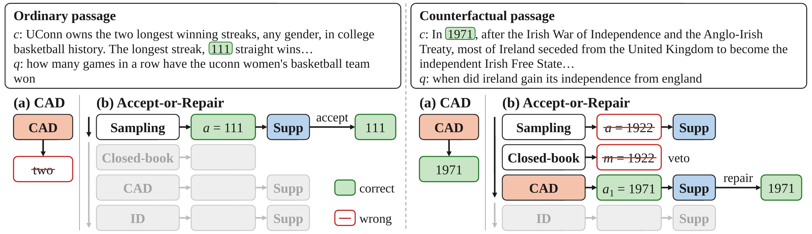
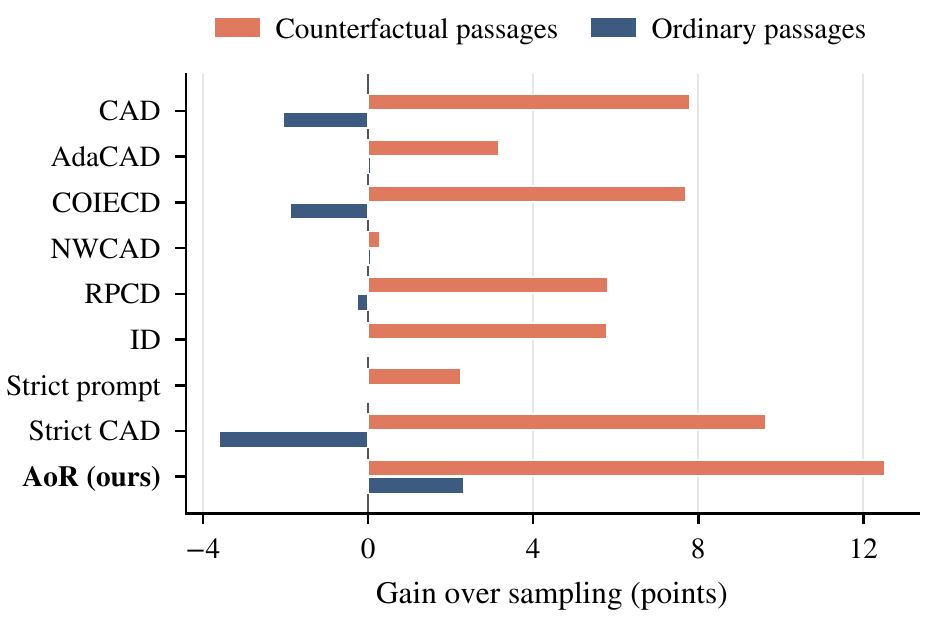

<p align="center">
  
</p>

<div align="center">

[](LICENSE)
[](https://www.python.org/)
[](https://github.com/js-lee-AI/AoR/actions/workflows/ci.yml)
[](https://github.com/js-lee-AI/AoR/stargazers)

<b><a href="#quick-start">Quick start</a> · <a href="#usage">Usage</a> · <a href="#browser-demo">Demo</a> · <a href="#settings">Settings</a> · <a href="#results">Results</a> · <a href="#reproduce-table-1">Reproduce</a> · <a href="#faq">FAQ</a> · <a href="#citation">Citation</a></b>

</div>

<p align="center">
  
</p>

<p align="center"><em>AoR on the four test questions that the paper shows as examples. It accepts a sampled answer that the passage supports (1) and repairs the others (2 to 4). The memory veto rejects a repair that repeats the closed-book answer (3) and masks its letter on a multiple-choice question (4). Open <code>demo/replay.html</code> in a browser to replay it.</em></p>

---

## News

- **[2026-10-21]** Code released, with the per-example scores behind the main results.

## Overview

Large language models often answer from what they learned in training, even when the passage in the prompt says otherwise. Contrastive decoding steers generation toward the passage by contrasting the token predictions under the full prompt with those under a modified prompt, at every token. It also changes answers that were already right: on ordinary passages, which agree with the model's knowledge, CAD turns correct answers into errors.

Accept-or-Repair (AoR) is a training-free procedure that checks an answer against the passage before deciding whether to change it.

* **Accept.** AoR samples a plain answer and returns it unchanged when the passage supports it. A short answer is supported when its normalized form occurs in the passage as a whole-token span; a multiple-choice answer when its option is the only option whose text occurs in the passage.
* **Repair.** Otherwise AoR draws up to two replacements, from CAD and then from Instructive Decoding (ID), and returns the first one that passes the same test.
* **Memory veto.** For an unsupported answer, AoR also samples a closed-book answer without the passage. When the passage favors another answer, repairs that repeat the closed-book answer are rejected, and on multiple-choice questions its letter is masked while the repairs are decoded.

Averaged over six models, AoR raises the score over plain sampling by 12.5 points on counterfactual passages and 2.3 points on ordinary passages. It is ahead of all eight contrastive and prompting baselines on both groups, while the baselines that gain most on counterfactual passages lose points on ordinary ones.

## What it does in one picture

<p align="center">
  
</p>

<p align="center"><em>(a) CAD contrasts every answer. (b) AoR accepts supported answers (Supp). When the passage favors another answer, the memory veto rejects repairs that repeat the closed-book answer m. Gray steps are skipped.</em></p>

## Quick start

```bash
git clone https://github.com/js-lee-AI/AoR.git
cd AoR
pip install -e .              # the procedure and the tables, CPU only
python examples/quickstart.py
```

The quickstart runs the procedure on the answers that the models gave to four test questions of the paper, so it needs no model:

```text
Checks on the recorded answers
  NQ-Original, Qwen3-8B: initial '111' supported=True
  NQ-Swap, Qwen3-8B: initial '1922' supported=False, closed-book '1922' vetoed=True
  NQ-Swap, Llama-3.1-8B: initial 'Jay Baruchel.' supported=False, closed-book 'Jay Baruchel.' vetoed=True
  FaithEval, Qwen3-14B: initial 'D. a bone' supported=False, closed-book 'D' vetoed=True

AoR on the recorded answers
  NQ-Original, Qwen3-8B: '111' (accepted)
      the passage supports the initial answer
  NQ-Swap, Qwen3-8B: '1971' (CAD repair)
      closed-book '1922' vetoed; CAD '1971' supported
  NQ-Swap, Llama-3.1-8B: 'Neal Dahlen' (ID repair)
      closed-book 'Jay Baruchel.' vetoed; CAD 'Jay Baruchel.' rejected; ID 'Neal Dahlen' supported
  FaithEval, Qwen3-14B: 'C. a mineral' (D vetoed, CAD fallback)
      closed-book 'D' vetoed, letter D masked; CAD 'C. a mineral' unsupported; no repair passes the support test, so the first one that is not vetoed is returned
```

To decode with a model, install the `run` extra (PyTorch, Transformers, Datasets) and pass a model:

```bash
pip install -e ".[run]"
python examples/quickstart.py --model qwen3-8b
```

Llama-3.1-8B-Instruct is gated on the Hugging Face Hub: request access on its model page and log in with `hf auth login` before loading it.

## Usage

### Answer questions with a model

```python
from aor import Example
from aor.hf import AcceptOrRepair

aor = AcceptOrRepair.from_pretrained("qwen3-8b")     # a short name of the paper or any Hugging Face id
ex = Example(
    question="when did ireland gain its independence from england",
    passage="In 1971 , after the Irish War of Independence and the Anglo - Irish Treaty , most of Ireland seceded "
            "from the United Kingdom to become the independent Irish Free State ...",
)
trace = aor(ex, seed=0)
print(trace.answer, trace.action, trace.decoder)    # action: accept, repair, fallback or initial
```

A multiple-choice question lists its options, and the prompt labels them A, B, C and so on:

```python
ex = Example(question="Which of the following would most likely form a fossil?", passage=passage,
             options=("a rock", "a crystal", "a mineral", "a bone"))
```

For many questions, `aor.run(examples, seed=0)` decodes them in batches and returns the traces with the number of tokens processed. Each decoding stage runs only on the examples that still need it: the closed-book answer and the repairs are drawn only for unsupported initial answers.

A `Trace` records every step: `initial` (the sampled answer), `closed_book`, `veto`, `masked_letter`, and `repairs`, the list of drawn repairs with their support test and whether the veto rejected them.

### Run the baselines

`aor.hf.Decoder` holds a model with every decoder of the main comparison at its selected setting:

```python
from aor.hf import Decoder

dec = Decoder.from_pretrained("llama3.1-8b")
out = dec.generate(examples, "cad", seed=0)    # sampling, cad, adacad, coiecd, nwcad, rpcd, id, strict, strict_cad
print(out.texts, out.forward_tokens)
```

All decoders draw tokens with the same counter-based noise, a hash of the seed, the example uid, the step and the token. Two decoders that reach the same distribution at a step pick the same token, so their answers are paired example by example. RPCD contrasts with the passage of another example, which `Example.partner_passage` holds; the task loaders fill it in.

### Bring your own decoders

The procedure does not decode. It takes batch functions, so it runs over any backend, such as an API or vLLM:

```python
from aor import accept_or_repair

def sample(idx):                  # plain answers for the examples at these indices
    ...
def closed_book(idx):             # answers to the question without the passage
    ...
def cad(idx, masked):             # masked[j] is an option letter that example idx[j] must not produce, or None
    ...
def id_(idx, masked):
    ...

traces = accept_or_repair(examples, sample, closed_book, [("cad", cad), ("id", id_)])
```

### The support test and the memory veto

Both read surface forms only:

```python
from aor import Example, PassageCheck

check = PassageCheck(Example(question="who voices hiccup in how to train your dragon 2",
                             passage="Neal Dahlen as Hiccup Horrendous Haddock III , the son of the Viking chief "
                                     "Stoick the Vast and Valka ."))
check.supports("Neal Dahlen")      # True
check.supports("Jay Baruchel.")    # False
check.vetoes("Jay Baruchel.")      # True: repairs that repeat it are rejected
```

### Command line

```bash
aor demo                                  # the four paper examples, no model
aor table --per-model --intervals         # Table 1 from records/, CPU
aor run --model qwen3-8b --out runs       # every method and seed on the five tasks, GPU
aor ask --model qwen3-8b --passage "..." --question "..."
```

`python -m aor` runs the same commands.

### Browser demo

Open `demo/replay.html` in any browser for the step-by-step replay above; it needs no install. The Gradio demo plays the same replay, lists every step of the four examples in a table with the passage, and with a model answers your own questions:

```bash
pip install -e ".[demo]"
python demo/app.py                                  # the paper examples, replayed without a model

pip install -e ".[demo,run]"
python demo/app.py --model qwen3-8b --device 0      # adds a tab for your own passage and question
```

### API at a glance

| Name | What it is |
|---|---|
| `Example(question, passage, options=(), ...)` | a question about a passage; options make it multiple choice |
| `PassageCheck(example)` | `supports(reply)`, `vetoes(closed_book)`, `masked_letter(closed_book)`, `option_scores()` |
| `accept_or_repair(examples, sample, closed_book, repairs)` | the procedure over batch decoders, one `Trace` per example |
| `aor.hf.Decoder` | a Transformers model with every decoder of the paper, `generate(examples, method, seed)` |
| `aor.hf.AcceptOrRepair` | AoR on a `Decoder`, `run(examples, seed)` or `aor(example, seed)` |
| `aor.methods.METHODS` | the decoders and their selected settings |
| `aor.data.load_split(task)` | development, test and scored examples of a task, from pinned dataset revisions |
| `aor.table` | Table 1 from the records or from your runs |
| `score(reply, example)` | token F1 for short answers, accuracy for multiple choice |

## Settings

Every method uses the sampling settings of the model, and contrastive adjustments come before temperature scaling and filtering.

| Model | Temperature | Top-p | Top-k |
|---|---|---|---|
| Qwen3-1.7B, 4B, 8B, 14B (non-thinking) | 0.7 | 0.8 | 20 |
| Llama-3.1-8B-Instruct | 0.6 | 0.9 | off |
| Mistral-7B-Instruct-v0.3 | 0.7 | 0.9 | off |

Contrastive settings were selected on the development split, one for all models and tasks: the setting with the highest average gain over sampling across the two task groups, or the setting recommended by the method's paper when it is within 0.1 points of the best. With γ the strength, CAD, RPCD, ID and Strict CAD score a token y by (1 + γ) log p(y | x) - γ log p(y | x'), where x is the prompt with the passage and x' the contrasted prompt.

| Method | Contrasted prompt x' | Selected | Settings tried |
|---|---|---|---|
| CAD | the question alone | γ = 1 | 0.25, 0.5, 1, 2 |
| AdaCAD | the question alone | γ = 1, scaled by the Jensen-Shannon divergence at each step | 0.5, 1, 2, 4 |
| COIECD | the question alone | strength 2, constraint scale 0.25 | (0.5, 0.25), (1, 0.25), (2, 0.25), (1, 0.1), (1, 0.5) |
| NWCAD | the question alone | divergence threshold 0.1 | 0.05, 0.1, 0.2, 0.3, 0.5 |
| RPCD | another example's passage | γ = 1 | 0.25, 0.5, 1, 2 |
| ID | the passage with an instruction to ignore it | γ = 2 | 0.25, 0.5, 1, 2, 4, 8 |
| Strict prompt | none; the prompt asks for an answer from the passage only | | |
| Strict CAD | the question alone, with the strict prompt as x | γ = 1 (CAD's) | |
| AoR | repairs with CAD (γ = 1), then ID (γ = 2) | up to 2 repairs | |

AoR draws the closed-book answer with seed 0 for every run, so the runs of all seeds share it. Answers are limited to 48 new tokens, 32 for multiple choice. Models run in bfloat16 with SDPA attention, loaded at the Hub revisions of the paper's runs (`aor.models.REVISIONS`).

## Results

<p align="center">
  
</p>

### Main comparison (paper Table 1)

Test scores averaged over six models and three seeds: F1 for free-form tasks, accuracy for FaithEval. Parentheses give the difference from sampling, with \* when its 95% paired cluster-bootstrap interval excludes zero. Cost is the number of tokens processed, prompts included, relative to sampling.

| Method | NQ-Swap | FaithEval | Counterfactual | NQ-Orig. | SQuAD | HotpotQA | Ordinary | Mean | Cost |
|---|---|---|---|---|---|---|---|---|---|
| Sampling | 56.9 | 63.6 | 60.3 | 76.0 | 84.5 | 63.5 | 74.7 | 67.5 | 1.00 |
| CAD | 62.4 | 73.7 | 68.1 (+7.8\*) | 72.5 | 84.6 | 60.8 | 72.6 (-2.1\*) | 70.3 | 1.18 |
| AdaCAD | 61.4 | 65.5 | 63.4 (+3.2\*) | 75.6 | 85.5 | 63.2 | 74.8 (+0.1) | 69.1 | 1.18 |
| COIECD | 62.2 | 73.7 | 68.0 (+7.7\*) | 72.7 | 84.5 | 61.1 | 72.8 (-1.9\*) | 70.4 | 1.18 |
| NWCAD | 57.3 | 63.8 | 60.6 (+0.3\*) | 76.0 | 84.5 | 63.7 | 74.8 (+0.1) | 67.7 | 1.18 |
| RPCD | 61.0 | 71.1 | 66.1 (+5.8\*) | 75.4 | 85.3 | 62.5 | 74.4 (-0.3) | 70.2 | 2.00 |
| ID | 64.3 | 67.8 | 66.0 (+5.8\*) | 74.8 | 85.6 | 63.6 | 74.7 (0.0) | 70.4 | 2.01 |
| Strict prompt | 60.3 | 64.8 | 62.5 (+2.2\*) | 76.0 | 84.9 | 63.1 | 74.6 (0.0) | 68.6 | 1.03 |
| Strict CAD | 64.7 | 75.1 | 69.9 (+9.6\*) | 70.9 | 84.1 | 58.3 | 71.1 (-3.6\*) | 70.5 | 1.21 |
| **AoR** | **65.2** | **80.4** | **72.8 (+12.5\*)** | **78.2** | **87.5** | **65.2** | **77.0 (+2.3\*)** | **74.9** | 1.71 |

### Mean of each model

| Method | Qwen3-1.7B | Qwen3-4B | Qwen3-8B | Qwen3-14B | Llama-3.1-8B | Mistral-7B |
|---|---|---|---|---|---|---|
| Sampling | 65.1 | 68.1 | 72.2 | 72.2 | 69.5 | 57.7 |
| CAD | 65.3 | 70.6 | 76.2 | 75.5 | 72.3 | 62.3 |
| AdaCAD | 65.9 | 69.4 | 73.3 | 73.2 | 71.9 | 60.9 |
| COIECD | 65.5 | 70.6 | 76.1 | 75.5 | 72.4 | 62.2 |
| NWCAD | 65.4 | 68.3 | 72.3 | 72.2 | 69.8 | 57.9 |
| RPCD | 65.8 | 70.4 | 74.3 | 74.6 | 71.2 | 65.1 |
| ID | 62.9 | 71.9 | 75.5 | 75.4 | 71.4 | 65.1 |
| Strict prompt | 64.1 | 68.5 | 73.0 | 73.0 | 73.3 | 59.6 |
| Strict CAD | 64.1 | 70.5 | 76.1 | 75.8 | 72.7 | 63.9 |
| **AoR** | **69.0** | **74.7** | **79.0** | **80.3** | **77.7** | **68.6** |

AoR's margin over every baseline is significant on both groups and on Mean (`tests/test_paper.py` checks this from the records).

## Reproduce Table 1

### From the records, on a CPU

`records/` holds the per-example scores of every method, model and seed on the scored test examples, the development, test and scored uids of each task with the cluster labels used by the bootstrap, and the mean number of tokens processed per example in every run. They rebuild both tables, their significance marks and the costs exactly:

```bash
aor table --per-model --intervals
python experiments/table1_main.py
pip install -e ".[test]" && pytest tests/test_paper.py
```

### From scratch, on a GPU

```bash
pip install -e ".[run]"
python experiments/run_main.py --models qwen3-8b --out runs     # resumes where it stopped
python experiments/table1_main.py --runs runs --models qwen3-8b
```

`aor run` and `experiments/run_main.py` load each task from the Hugging Face revision that the paper used and draw the same 200 development and 800 test examples. Test examples whose question, or for SQuAD whose passage, also occurs in the development split are left out of the scores, which keeps 724 of the 800 on NQ-Swap, NQ-Original and SQuAD.

A rerun matches the records closely but not on every example. Batch sizes follow the free GPU memory, and bfloat16 kernels round slightly differently when the batch changes, which can flip a sampled token. On Qwen3-1.7B with seed 0, a rerun of the ten methods on one RTX A6000 (53 minutes) gave the same score as the records on 98.2% of the scored examples. Task scores moved by at most 1.4 points, the Mean of each method by at most 0.4 points, and AoR's gain over sampling by at most 0.1 points.

Cost counts the tokens that each run processes. For AoR, the records charge each closed-book answer and each repair the mean number of tokens per example of its decoder's full run, while `aor run` counts the tokens of AoR's own calls. In the rerun above, the two counts differ by at most 3.5% on any task.

## Repository layout

```text
aor/
  example.py      Example, a question about a passage
  support.py      the support test and the memory veto (PassageCheck)
  procedure.py    Accept-or-Repair over batch decoders
  prompts.py      the prompts of the paper
  methods.py      the decoders of the main comparison and their settings
  models.py       the six models, their sampling settings and Hub revisions
  decoding.py     batched contrastive decoding with shared sampling noise (torch)
  hf.py           Decoder and AcceptOrRepair on Transformers models
  data.py         the five tasks, pinned dataset revisions and splits
  scoring.py      token F1 and multiple-choice accuracy
  run.py          runs of the main comparison
  stats.py        aggregation and the paired cluster bootstrap (numpy)
  records.py      per-example results on disk
  table.py        Table 1 from the records or from runs
  demo.py         the four paper examples, replayed
  cli.py          the aor command
demo/             the browser demo (app.py, Gradio) and the step-by-step replay (replay.html)
examples/         quickstart
experiments/      run_main.py and table1_main.py
records/          per-example scores behind Table 1
tests/            the procedure, scoring, decoding, the replay page, and Table 1 from the records
```

## FAQ

<details>
<summary><b>Why not apply contrastive decoding to every answer?</b></summary>

On ordinary passages most sampled answers already occur in the passage, and they are more accurate than those that do not. Contrastive decoders change some of them into errors, which is why CAD, COIECD and Strict CAD lose points on ordinary passages. AoR returns a supported answer as it was sampled, so contrastive decoding only touches answers that the passage does not support.
</details>

<details>
<summary><b>Does AoR need training, a second model or a verifier?</b></summary>

No. The support test and the memory veto compare strings with the passage, and the closed-book answer and the repairs come from the same model with other prompts.
</details>

<details>
<summary><b>What does it cost?</b></summary>

1.71 times the tokens of plain sampling on average, between CAD (1.18) and ID (2.01). An accepted answer costs one sampling pass; the closed-book answer and the repairs are drawn only for unsupported answers, and a repair that passes ends the example.
</details>

<details>
<summary><b>Can I use other repair decoders or strengths?</b></summary>

Yes: `AcceptOrRepair(decoder, repairs=("cad", "rpcd"), strengths={"cad": 0.5})` takes any decoder in `aor.methods.METHODS`, and `accept_or_repair` takes your own batch functions.
</details>

<details>
<summary><b>Which answers can the support test check?</b></summary>

This code implements the tests of the main comparison: short free-form answers, which must occur in the passage as a whole-token span after normalization (yes and no always pass), and option letters, whose option text must be the only one in the passage. Long answers that paraphrase the passage need another test.
</details>

<details>
<summary><b>Why are the counts 724 and not 800 on three tasks?</b></summary>

A test example that shares its question with a development example, or its passage for SQuAD, was in effect seen when the settings were chosen, so it is left out of the scores. `records/splits.json` lists the scored uids.
</details>

## Citation

Citation details and BibTeX will be added when the paper's preprint is publicly available.

## License

The code is released under the [MIT License](LICENSE). The datasets keep the licenses given on their dataset cards: MIT for NQ-Swap and CC BY-SA 4.0 for SQuAD and HotpotQA; the FaithEval card names none. `records/` holds example uids and scores only. The demo quotes three passages of the NQ-Swap dataset and three sentences of a FaithEval passage.

## Acknowledgments

We thank the authors of the contrastive decoding methods compared here for describing them in detail, and the creators of NQ-Swap, FaithEval, SQuAD and HotpotQA for releasing their data. Decoding builds on Hugging Face Transformers, and the tasks load through Hugging Face Datasets.
